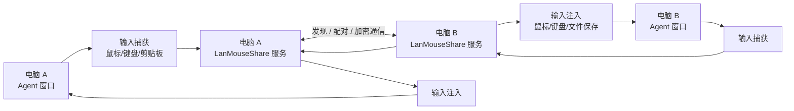
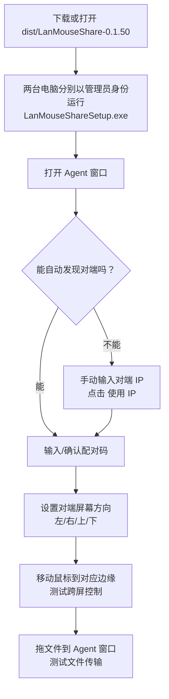

# LanMouseShare 0.1.56 项目说明与使用指南

LanMouseShare 是一个局域网内两台 Windows 电脑共享鼠标、键盘、剪贴板和文件传输的小工具。当前最终版 `0.1.50` 把主控端与被控端的关系重写成一份可验证的状态关系书（`docs\CONTROL-STATE-MODEL.md`）并据此重构了控制层：控制权改为“租约 + 确认”模型，任一侧掉线、崩溃或拔网线都会在 1 秒内自动回到空闲状态，不会再出现两端同时自认主控、键鼠一起卡死的情况。0.1.47 又为租约/确认补了一条经 Service 的中继通道：即使 Windows 防火墙挡住了 Agent 之间的 UDP 47534，跨屏控制也不会失效。0.1.50 在此基础上解决延迟与带宽：输入包改用紧凑帧（相对移动每事件 2 字节、绝对定位每事件 4 字节，约 9 字节一帧可带多条事件），交互流量打 DSCP 46（EF）、日志流量打 DSCP 8 并在输入活跃时限流，另外日志推送可在界面上直接关闭（日志仍先写本机），剪贴板可以直接跨屏复制粘贴文件。

## 项目结构

```text
LanMouseShare
├─ src
│  ├─ Desktop.Agent      # 桌面端窗口、托盘、快捷键、鼠标键盘捕获与注入、控制通道（UDP 47534）
│  ├─ Host.Service       # 后台服务，负责发现、配对、网络通信、文件流、日志收集与推送
│  ├─ Input.Native       # Windows 输入钩子、SendInput、边缘切屏检测
│  ├─ Shared.Core        # 协议、配置、加密、IPC DTO、控制状态机、日志协议
│  └─ Setup              # 单文件安装器
├─ scripts               # 安装服务、卸载服务、打包、日志、回退清理脚本
├─ docs                  # 包说明、状态关系书、手动测试说明和测试记录
├─ tests                 # Shared.Core.Tests 控制逻辑测试
└─ dist                  # 各版本发布包
```

## 工作原理



核心链路是：

1. 两台电脑都安装并启动 Agent 和 Service。
2. Service 负责局域网发现、配对、加密通信和文件传输。
3. Agent 负责界面、键鼠捕获、跨屏判断、快捷键和本机输入注入。
4. 鼠标碰到配置方向的屏幕物理边缘并继续向外移动时，切换当前控制目标。
5. 当前控制目标是哪台电脑，两端键盘都应该输入到哪台电脑。

## 安装和首次使用



推荐安装方式：

1. 在两台电脑上分别运行 `dist\LanMouseShare-0.1.50\LanMouseShareSetup.exe`。
2. 安装器需要管理员权限，用于安装本地服务和配置防火墙。
3. 两台电脑都打开 Agent 窗口。防火墙需要放行 TCP `47532`、`47540` 和 UDP `47531`、`47533`、`47534`。
4. 等待自动发现对端。如果没有发现，就在“手动输入对端 IP”里填另一台电脑的 IPv4 地址。
5. 发起配对，并在另一台电脑上同意配对。
6. 设置对端屏幕方向，比如电脑 B 在电脑 A 右侧，就在 A 上选择“对端在右”。
7. 把鼠标移动到配置方向的屏幕边缘，即可跨屏。

## 主要功能

- 鼠标跨屏控制：不使用 12px 推入阈值，碰到配置方向物理边缘并继续向外移动即可切屏。
- 单一主控：控制权是租约（lease），任一时刻最多只有一台主控端，两端几乎同时切屏也由 epoch + 设备号裁决成唯一结果。
- 自动恢复：主控端 700 毫秒收不到被控端确认就松开本机键鼠；被控端 600 毫秒收不到租约就停止注入并回到空闲，卡死时间上限约 1 秒。
- 被控端永不夺权：光标推到自己屏幕边缘只发“请求放开”，由主控端决定什么时候把光标放回来。
- 键盘跟随当前控制目标：当前目标是哪台电脑，两端键盘都输入到那台电脑。
- 剪贴板同步：支持文字和图片剪贴板同步，可在界面关闭。
- 文件传输：把普通文件拖到 Agent 窗口发送，对端保存到桌面 `Mouse传输文件` 文件夹。
- 配对保护：配对异常、设备 ID 不匹配、旧信任残留时会阻断跨屏输入。
- 边角阻挡：可开启“跨屏边角阻挡”，避免从屏幕角落误穿屏。
- 界面滚动：窗口内容过长时，中间设置区可用鼠标滚轮上下滚动。
- 调试日志：可把电脑设为主控端或被控端，被控端日志实时汇总到主控端，保留 3 天，便于排查问题。

## 主控与被控端的状态关系（0.1.50）

完整规范见 `docs\CONTROL-STATE-MODEL.md`，实现体是 `src\Shared.Core\Control\ControlLinkMachine.cs`。要点：

| 状态 | 含义 | 本机键鼠 | 收到的远端输入 |
| --- | --- | --- | --- |
| `Idle` | 空闲，两台电脑各管自己的键鼠 | 全部本地处理 | 丢弃 |
| `Owner` | 本机是主控端，输入发往对端 | 被抑制 | 忽略（本机不是目标） |
| `Target` | 本机被控，接收对端输入 | 仍然本地有效 | 注入到本机 |

- 主控端每 50 毫秒发一次租约（`ControlLease`），被控端回 `ControlAck`；确认丢失超过 700 毫秒，主控端自动回到 `Idle` 并恢复本机键鼠。
- 租约与确认有两条语义相同的路径：Agent 之间的 UDP 47534 直连（快路径），以及经已配对服务通道的中继（Agent → 本机 Service → 对端 Service → 对端 Agent，复用现有防火墙规则）。直连被挡时自动走中继，`control.link.arbitrated` 的 `path=udp` / `path=relay` 可以看出当前用的哪条。
- 被控端的租约有效期 600 毫秒，到期未续自动停止注入并回到 `Idle`。
- 被控端从不自行进入 `Owner`；退回光标只发释放请求（带远端坐标与方向），由主控端处理释放并把光标放回本机边缘。
- 两端同时申请时按 `epoch` 升序再按设备 ID 稳定裁决，输的一方记录 `control.link.arbitrated` 并回到 `Idle`。
- 角色、租约、超时、裁决全部走 `control.link.*` 日志事件，中继失败另有 `control.lease.relay.fail` / `control.ack.relay.fail`，可以直接还原每一次状态迁移。

### 0.1.47 的指针与键盘修正

- **绝对坐标注入**：在远端屏幕范围内，主控端发 `InputKinds.MouseMove` 绝对位置（远端像素），被控端按 `MOUSEEVENTF_ABSOLUTE` 注入，避免相对增量被本机指针加速曲线缩放而越走越慢、到不了边界。
- **边界相对增量**：只有顶到远端屏幕边界时才改发 `MouseMoveRelative`，把“继续往外推”的意图传给被控端边缘检测。
- **返回需要真的推出去**：`RemoteEdgeReturnDetector` 改为有状态，250 毫秒内累计向外 ≥ 12 像素才判定 `EdgePush`，判定后 500 毫秒冷却；停在边缘或单次抖动不再把控制权丢回主控端。
- **钳位不算注入失败**：指针在屏幕边界被 Windows 钳住时本来就不会移动，只记 `mouse.clamp.suspected`，不再触发“注入失败 → 释放控制”。这是 0.1.46 及更早版本“鼠标莫名退回主控端”的直接原因。
- **键盘不留粘键**：注入的按键被跟踪，控制权结束/暂停/掉线时统一补发抬起；新增 `key.forward` / `key.inject` 日志可逐键核对两端。

## 快捷键

默认快捷键：

| 功能 | 默认快捷键 | 说明 |
| --- | --- | --- |
| 暂停/恢复跨屏 | `Ctrl+F11` | 暂停后键鼠、剪贴板、文件发送都停止 |
| 停止控制 | `Ctrl+F10` | 两端同时停止所有对端控制 |
| 关闭程序 | `Ctrl+Alt+End` | 退出 Agent |

快捷键可以在 Agent 界面的快捷键区域修改。

## 文件传输

使用方式：

1. 确认两端已配对并连接。
2. 把文件拖到 Agent 窗口。
3. 对端接收完成后，会保存到桌面：

```text
Mouse传输文件
```

注意：暂停状态、配对异常、未连接时不会开始新的文件传输。

接收目录使用公共桌面 `C:\Users\Public\Desktop\Mouse传输文件`，因为服务以 LocalSystem 运行，用户桌面路径对服务不可见；公共桌面在登录用户的桌面上同样可见。

### 跨屏复制粘贴文件（0.1.50）

在一台电脑的资源管理器里复制文件（`Ctrl+C`），切到另一台电脑后直接 `Ctrl+V`：Agent 检测到剪贴板里是文件，就会把这些文件经文件通道传过去，传输完成后自动把对端文件列表放进剪贴板，于是可以直接粘贴。剪贴板提示和文件到达的先后顺序不影响结果（`clipboard.files.detected` / `clipboard.files.applied`）。单个文件仍然受现有文件传输通道的能力限制，超大文件请直接用拖拽或共享文件夹。

## 传输优先级、帧压缩与日志开关（0.1.50）

1. **交互优先**：输入包（UDP 47534 直连和经 TCP 中继的输入）打 `DSCP 46`（EF，加速转发），日志流打 `DSCP 8`（后台类）。启用了 QoS 的交换机会优先转发前者。日志里可见 `net.input.socket udp=47533 qos=dscp46` 和 `DirectInputChannel listening on UDP 47534 qos=dscp46`。
2. **紧凑帧**：直连通道升到 v3 帧格式的扩展类型——相对移动每事件 2 字节（`sbyte dx,dy`），绝对定位每事件 4 字节（`ushort x,y`），一帧最多 200 个事件；装不下或含按键/滚轮时自动回退到通用帧。典型指针流原来约 3 KB/s，现在约 100–200 B/s。
3. **日志限流**：输入活跃（250 ms 内有输入）时，日志推送批大小从 200 行降到 20 行、间隔从 120 ms 放宽到 60 ms，避免日志把上行带宽吃满。
4. **可关闭日志推送**：Agent 界面“调试日志”区域新增“推送日志到主控端”开关。关闭后日志仍然写在本机 `%ProgramData%\LanMouseShare\Logs\live`，只是不再向主控端推送；状态行会显示“日志推送已关闭（仅保存在本机）”。
5. 主控端界面状态行会显示实测网络延时（心跳 RTT，`net.rtt`），用来判断卡顿是链路还是注入问题。

## 调试日志与排障

两台电脑需要先确定角色：一台是主控端（Controller），另一台是被控端（Agent）。

1. 在被控端 Agent 的“调试日志”区域，角色选择“被控端”，填写主控端地址，例如 `192.168.1.20:47540`。留空时会自动使用已发现或已配对的主控端地址。
2. 在主控端 Agent 的角色选择“主控端”。调试口令可选，但两端填了就必须一致。
3. 两端保存后查看“日志状态”，被控端显示“日志推送：已连接”，主控端显示“日志收集：N 台被控端已连接”。
4. 勾选“详细日志”会额外记录每一次输入、传输、状态变化的细节，排查完记得关闭。

日志位置：

```text
%ProgramData%\LanMouseShare\Logs\live    本机日志（Agent 和 Service 都写这里）
%ProgramData%\LanMouseShare\Logs\remote  被控端汇总过来的日志，按 设备名_设备ID 分目录
```

- 日志保留 3 天，启动时和每 6 小时自动清理。可在界面把保留天数改成 1 到 30。
- 需要抓现场时，先在被控端复现问题，然后到主控端“打开汇总日志”目录取文件。
- 日志传输使用 TCP `47540`，需要两端防火墙放行；`scripts\Configure-Firewall.bat` 和安装器已经包含这条规则。
- 一键收集：在主控端点击“打开日志”，再点“打开汇总日志”，把两个目录一起打包发给开发者即可。

### 每台电脑的系统信息文件

0.1.44 起，Service 和 Agent 启动时会在日志根目录各写一份系统信息文件：

```text
%ProgramData%\LanMouseShare\Logs\SystemInfo-Service.txt
%ProgramData%\LanMouseShare\Logs\SystemInfo-Agent.txt
```

内容包括操作系统版本与架构、计算机名、CPU 和内存、每台显示器的分辨率与 DPI、每块网卡的描述/MAC/IPv4/IPv6/网关、程序版本与进程位数、关键端口（47532、47540）监听状态、当前角色和主控端地址。文件里不含密钥和口令。

被控端连上主控端后会自动把这份文件推到 `remote\<设备名_设备ID>\SystemInfo-Agent.txt`，在主控端点“打开汇总日志”就能一起取到。

### 排查用的日志事件

| 事件名 | 含义 |
| --- | --- |
| `control.link.role` | 控制链角色切换（Idle/Owner/Target），带 epoch、目标设备、原因 |
| `control.link.begin` | 主控端开始控制对端（带 epoch、方向、远端屏幕） |
| `control.link.released` | 释放控制（带原因、epoch、是否通知对端） |
| `control.link.lease` | 主控端租约与确认统计，含冻结原因（每 2 秒汇总一次） |
| `control.link.ack.lost` / `control.link.lease.stale` | 确认丢失 / 租约过期（超时） |
| `control.link.timeout` | 租约或确认超时导致自动回收，WARN |
| `control.link.arbitrated` | 两端同时申请，按 epoch/设备号裁决出唯一主控 |
| `control.link.stale` / `control.link.stale.ignored` | 收到过期 epoch 的释放/控制消息并忽略 |
| `control.link.ack.sent` | 被控端回复确认（DEBUG） |
| `screen.switch.out` / `screen.switch.back` | 光标从本机边缘切到对端 / 从对端退回本机 |
| `screen.switch.return` | 被控端收到“退回本机”的请求 |
| `edge.switch.arm` / `edge.switch.reset` | 边缘切换重新武装 / 被冷却锁存 |
| `mouse.local.position` / `mouse.remote.position` | 本机鼠标像素坐标 / 远端输入注入到本机后的坐标 |
| `mouse.screen.change` | 鼠标所在显示器变化，记录虚拟桌面坐标与屏幕序号 |
| `net.rtt` | 心跳往返延时（毫秒）与发送结果，超时或高延时会记为 WARN |
| `input.ignored` | 收到远端输入但本机不是目标，按 2 秒汇总一次 |
| `clipboard.send` / `clipboard.apply` / `clipboard.failed` | 剪贴板发送、应用、失败 |
| `ui.stall` | 界面线程停顿超过 800 毫秒（输入卡顿的直接证据） |

## 回退和清理

如果要回退旧版本，先运行桌面脚本：

```text
LanMouseShare-Rollback-Clean.bat
```

这个脚本会：

- 关闭 Agent。
- 停止并删除 `LanMouseShare` 服务。
- 删除管理员计划任务 `LanMouseShare.Agent.Admin`。
- 删除开机自启动项。
- 删除安装版本注册表，避免老安装器跳到新版本。
- 把 `C:\Program Files\LanMouseShare` 移动备份。
- 把 `C:\ProgramData\LanMouseShare\config.json` 移动备份。

清理后再安装你想使用的旧版本。不要混用旧 Agent 和新 Service。

## 常见问题

### 老版本安装器一打开就跳到新版本

原因通常是系统里还残留：

```text
C:\Program Files\LanMouseShare
HKLM\Software\Microsoft\Windows\CurrentVersion\Uninstall\LanMouseShare
```

运行 `LanMouseShare-Rollback-Clean.bat` 后再安装老版本。

### 向日葵、Mouse without Borders 等远控软件窗口控制不了

这类软件可能主动过滤 Windows 的模拟输入事件。管理员权限不一定能解决，因为对方软件可能是为了防止远控套远控造成输入回环。当前建议是避开直接控制这类窗口，或在需要时先暂停 LanMouseShare。

### 两端显示配对状态不一致

建议：

1. 两台电脑都点停止控制或退出 Agent。
2. 运行回退清理脚本或手动清理配置。
3. 重新安装同一版本。
4. 重新配对。

### 关闭窗口后服务还在

如果没有开启“关闭窗口时最小化到托盘”，关闭 Agent 会请求本地服务退出。若仍残留，可运行：

```bat
net stop LanMouseShare
sc delete LanMouseShare
```

### 两边键鼠突然都不动

0.1.43 曾出现“两台电脑都以为自己是主控端”的互相锁死：两边都吞掉本地输入并转给对方，对方又因为自己不是目标而丢弃，于是两边都像死机。0.1.44 先做了止血（被控端退回不再自封主控、500ms 冷却、12px 重新武装距离），0.1.45 才从结构上解决：控制权变成租约 + 确认，角色只有 `Idle`/`Owner`/`Target`，被控端永远不能自封主控，任一侧超时就自动回到空闲，卡死时间上限约 1 秒。0.1.47 再补上中继通道，避免租约直连被防火墙挡住时出现“完全切不过去”。

如果旧版本现场卡住，按 `Ctrl+F10`（停止控制）或 `Ctrl+F11`（暂停）就能立刻恢复本机键鼠，然后两台电脑都升级到 `0.1.50`。

## 发布产物

当前最终版产物：

```text
dist\LanMouseShare-0.1.50\LanMouseShareSetup.exe
dist\LanMouseShare-0.1.50\LanMouseShare-0.1.50-source.zip
dist\LanMouseShare-0.1.50\Agent\             桌面端可执行文件
dist\LanMouseShare-0.1.50\Service\           服务端可执行文件
dist\LanMouseShare-0.1.50\Scripts\           安装、卸载、日志、回退脚本
dist\LanMouseShare-0.1.50\Docs\              说明文档
dist\LanMouseShare-0.1.50\README.md          安装包说明
dist\LanMouseShare-0.1.50\PROJECT_GUIDE.md   完整说明
dist\LanMouseShare-0.1.50\使用说明-先看我.md  简明说明
```

打包步骤：

1. 构建 Release：`MSBuild.exe LanMouseShare.sln /t:Build /p:Configuration=Release`。
2. 运行 `powershell -ExecutionPolicy Bypass -File scripts\Build-Installer.ps1`。
3. 脚本把 `Agent\`、`Service\`、`Scripts\`、`Docs\` 和根目录 md 压成一个 `payload.zip`，只把这一个文件嵌入 `LanMouseShareSetup.exe`，安装时解压到安装目录。
4. 不再逐个嵌入文件，体积更小，也不容易触发杀毒软件的“自解压多可执行文件”启发式。

每次发布都建议保留独立版本目录，方便回退。

## 0.1.52 延时与切屏稳定性修复

0.1.51 的双机实测暴露出三类问题，0.1.52 逐条处理：

- **控制信令不再每条报文新建 TCP 连接。** 原来 Service 每发一条消息（心跳、租约中继、确认）都会新建一次 TCP 连接，200 ms 心跳加上 100 ms 中继，等于每 50–100 ms 做一次三次握手，握手没完成就超时，控制权被反复回收。现在主控端对每个对端保持一条**持久 TCP 连接**，对端 Service 重启时自动重连，失联时心跳探测接管。
- **租约/确认改走 Service 中继。** 被控端把租约和确认通过已配对的 TCP 通道中继给主控端（100 ms 一次），UDP 47534 只负责鼠标键盘数据。即使 UDP 被防火墙挡住，控制权也不会被误判超时。
- **输入帧带序号。** 每条输入帧带 16 位序号，重复包、倒退包直接丢弃，避免 U 路上重复或乱序的输入造成「指针抖一下」。
- **切屏锁存。** 进入远端或被控端释放后，必须把光标移离边缘 **≥16 px** 并经过 **500 ms** 才重新武装。以前光标停在边缘，被控端一松手主控端立刻又切过去，来回弹跳。

日志建议：排障完把「详细日志」关掉，被控端如果带宽紧张可以勾掉「推送日志到主控端（关闭后仅保存在本机）」；日志本身仍在本地保留 3 天。
## 0.1.53 – 0.1.56 稳定性与剪贴板

- 0.1.53：控制信令改为常连接 TCP，修掉每条报文都新建连接的连接风暴；被控端不再因注入判定误判而抢回控制权；相对移动积压超过 150ms 直接丢弃，避免「卡几秒后回放」。
- 0.1.54：复制文件不再立刻整包发送，改为「公告 + 粘贴时拉取」。
- 0.1.56：公告改走 UDP 控制通道（≤1s）；文件夹自动 zip 打包与解包；读剪贴板失败自动重试；新增「取消传输」；粘贴到不支持文件的程序静默。

## 0.1.56 版本变化

- 跨屏粘贴文件改为主控端发起请求：主控端按下 Ctrl+V 时若本机剪贴板是文件，就吞掉按键并通知被控端自己拉取、写剪贴板、本地粘贴。原因是两端的低级输入钩子都会丢弃注入型按键，被控端根本收不到注入的 Ctrl+V。
- 远端注入不再依赖界面线程：UDP 收到输入后直接在被控端线程注入，窗口最小化或界面繁忙时不再出现「控制不了鼠标、延迟大增」。
- 写剪贴板改到独立 STA 线程并 Flush，避免阻塞界面线程，也避免线程退出后文件列表消失。
- 新增日志事件：`clipboard.paste.request`、`clipboard.paste.request.nofiles`。
