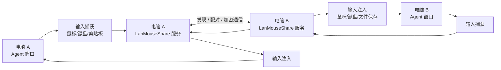
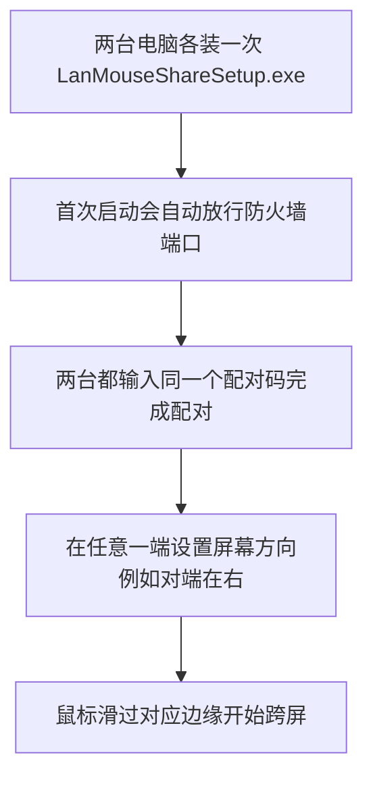

# LanMouseShare 0.2.0-beta-fix24 项目说明与使用指南

LanMouseShare 是一个局域网内两台 Windows 电脑共享鼠标、键盘、剪贴板和文件传输的小工具：鼠标滑过屏幕物理边缘就能接管另一台，键盘、剪贴板、文件都跟着当前控制目标走，不需要 KVM 硬件。

当前版本 `0.2.0-beta-fix24`（`AssemblyFileVersion 0.2.1.9`，.NET Framework 4.8 + WPF）。核心结构是「租约 + 确认」的控制状态机：角色只有 `Idle` / `Owner` / `Target` 三种，被控端永远不能自封主控，任一侧掉线、崩溃或拔网线都会在 1 秒内回到空闲，不会出现两端同时自认主控、键鼠一起卡死的情况。

这一版相对早期 `0.1.x` 的关键变化：

- 控制权从“谁先抢到谁算”改成租约 + 确认，并保留经 Service 的中继通道，UDP 被防火墙挡住也能跨屏。
- 剪贴板的所有 OLE 调用移出 UI 线程（fix16），并修掉了跨线程读界面开关导致进程直接退出（fix17）。
- 文件传输改成“拖进窗口或右键发送、接收方直接落桌面”，同时彻底关闭“复制文件 → 对端 Ctrl+V”（fix10）。
- 卸载补齐三个正规入口（fix13），整套图标统一（fix18），返回手势改用武装 + 驻留 + 阈值 + 冷却四道闸（fix19），不再被快速左扫误触发。

## 项目结构

```text
LanMouseShare
├─ src
│  ├─ Desktop.Agent      # 桌面端窗口、托盘、快捷键、鼠标键盘捕获与注入、控制通道（UDP 47534）
│  ├─ Host.Service       # 后台服务，负责发现、配对、网络通信、文件流、日志收集与推送
│  ├─ Input.Native       # Windows 输入钩子、SendInput、边缘切屏检测
│  ├─ Shared.Core        # 协议、配置、加密、IPC DTO、控制状态机、日志协议
│  └─ Setup              # 单文件安装器
├─ scripts               # 编译打包、防火墙、诊断、回退清理脚本
├─ docs                  # 状态关系书、修复总结、手动构建与测试说明
├─ tests                 # Shared.Core.Tests 控制逻辑测试
└─ dist                  # 各版本发布包（不进 git）
```

## 工作原理



核心链路是：

1. 两台电脑都安装并启动 Agent 和 Service。
2. Service 负责局域网发现（UDP 47531）、配对、加密通信和文件流。
3. Agent 负责界面、键鼠捕获（低级钩子）、跨屏判断、快捷键和本机输入注入。
4. 鼠标碰到配置方向的屏幕物理边缘并继续向外移动时，切换当前控制目标。
5. 当前控制目标是哪台电脑，两端键盘就都输入到哪台电脑。

## 安装和首次使用



1. 每台电脑运行 `dist\LanMouseShare-0.2.0-beta-fix24\LanMouseShareSetup.exe`，默认装到 `C:\Program Files\LanMouseShare`。
2. 安装后防火墙需放行 **UDP 47531 / 47533 / 47534** 与 **TCP 47532 / 47540 / 47541**。安装器会自动加规则；若被组策略或第三方安全软件覆盖，手工补上即可，否则跨屏会“能看到对方但切不过去”。
3. 两台都启动 Agent，在“配对”里输入同一个配对码，一端“发起”、另一端“同意”。配对成功后两端都会显示“已配对”。
4. 在“屏幕位置”里设置对端的方位（上/下/左/右）。方向决定从哪条边切出去。
5. 用鼠标滑过那条边并向屏幕外继续移动，控制权切到对端：对端鼠标跟着动，键盘输入也送到对端。
6. 从对端沿反方向快速外推即可把控制权收回来，也可以在界面点“停止控制”。
7. 用 Ctrl+F11 可临时暂停（暂停后键鼠、剪贴板、文件发送全部停止），再按一次恢复。

## 主要功能

- **跨屏鼠标**：碰到屏幕物理边缘并继续外推即切换，不需要移动阈值；支持上下左右四个方向与边角阻挡。
- **单一主控**：控制权是「租约 + 确认」，50ms 级租约、700ms 内没确认就回 Idle；被控端租约 600ms，且永不自封主控。
- **自动恢复**：任一端掉线、崩溃、拔网线，另一端在 1 秒内回到空闲，不会卡死。
- **键盘跟随**：键盘输入始终送到当前控制目标，不留在本机。
- **剪贴板共享**：文本与图片双向同步，可在界面关闭。剪贴板读写全部在一条常驻 STA 线程上执行（fix16），写失败重试上限 3 次，不会堵住低级鼠标钩子所在的 UI 线程。
- **文件传输**：把文件拖进窗口，或在资源管理器里右键「传输到对端」，文件**直接落到对方桌面**（fix10；不再套 `Mouse传输文件` 子目录）；fix22 起接收目录可自定义。
- **不再支持“复制文件 → 对端 Ctrl+V”**：fix10 起彻底关闭，被控端收到文件粘贴请求会直接忽略（日志 `clipboard.files.ignored reason=disabled-fix10`）。
- **配对保护**：配对码 + 加密通道；日志推送可在界面关闭（关闭后仅保存本机）。
- **桌面集成**：托盘常驻、可选开机自启、统一应用图标（fix18）、三个卸载入口（fix13）。
- **界面**：左侧连接/配对/文件传输，右侧屏幕位置与输入设置，窗口可滚动，小屏也能完整操作。

## 主控与被控端的状态关系

状态机实现见 `src\Shared.Core\Control\ControlLinkMachine.cs`，设计说明见 `docs\CONTROL-STATE-MODEL.md`。

| 角色 | 含义 | 本机键鼠 | 收到的远端输入 |
| --- | --- | --- | --- |
| `Idle` | 空闲，本机自己用 | 正常执行，不拦截 | 丢弃（2 秒汇总记一次 `input.ignored`） |
| `Owner` | 主控端，正在控制对端 | 拦截并转发给对端（鼠标移动除外仍本机处理） | 不接受 |
| `Target` | 被控端，正被对端控制 | 本地输入被忽略/拦截 | 注入到本机 |

要点：

- 两台都可能处于 `Idle`，但同一时刻只允许一台 `Owner`、一台 `Target`。
- 租约与确认走 UDP 47534 直连，直连不通时自动降级为经 Service 中转（日志 `control.link.arbitrated` 里 `path=udp` / `path=relay`）。
- `Owner` 侧 700ms 收不到确认就主动回 `Idle`；`Target` 侧 600ms 收不到租约也回 `Idle`，谁都不会“自封主控”。
- 冲突裁决看 epoch + 设备 ID，旧的租约不会被重新武装。
- 相关日志事件：`control.link.role`、`control.link.lease`、`control.link.ack`、`control.link.release`、`control.link.timeout`、`control.conflict`。

## 指针与键盘

- 注入用绝对坐标（`SendInput` + 虚拟桌面归一化），多显示器也准。
- 远端指针贴边时只发相对增量，不会因为归一化精度在边缘抖动。
- **返回手势（fix19）**：从对端把控制权收回本机，需要同时满足四道条件——进屏后指针真正深入对端 ≥ 40px 才“武装”；触到返回边后**连续驻留 ≥ 260ms**；320ms 窗口内累计外推 ≥ 140px；一次返回后 700ms 冷却。以前只要快速左扫（57ms 内扫完 254px）就会被当成“要退回”，导致刚切过去就被弹回本机、随后的点击落在本机。
- 钳位（指针被限制在屏幕内）不算注入失败。
- 键盘不留粘键：切屏、释放、暂停时统一抬起所有按下的键。

## 快捷键

| 快捷键 | 作用 |
| --- | --- |
| `Ctrl+F11` | 暂停 / 恢复（键鼠、剪贴板、文件发送一起停） |
| `Ctrl+F10` | 停止控制，立刻把控制权收回本机 |
| `Ctrl+Alt+End` | 退出 Agent |

三个都可以在界面“快捷键”里改。

## 文件传输

1. 在发送方把文件拖进 Agent 窗口，或在资源管理器里右键文件/文件夹选「传输到对端」。
2. 接收方直接落盘到**当前用户桌面**（用户桌面不可写时依次退到公共桌面、下载、LocalAppData）；**fix22 起可在 Agent 的「文件传输」卡片里「更改接收目录…」指定任意目录**（每台各设各的，目录不可写时自动退回桌面并记 `transfer.dir.custom.invalid`）。
3. 传输中可在界面“取消传输”；文件较大时会有进度显示。

说明：接收目录的兜底顺序见 `src\Desktop.Agent\MainWindow.xaml.cs` 的目录解析逻辑；Service 以 LocalSystem 运行时另有公共桌面兜底路径。

## 剪贴板共享

- **支持**：文本、图片（图片上限 10MB，PNG 编码后传输）。
- **不支持**：文件列表的跨屏粘贴（fix10 关闭；复制文件不会同步到对端）。
- 两端都带 2 秒抑制窗口和 origin 回环校验，自己写的剪贴板不会再被自己读一遍发出去。
- 所有 `Clipboard.*` 调用集中在 `src\Desktop.Agent\ClipboardSyncService.cs`，并且只在 `ClipboardWorker` 那条常驻 STA 线程上执行；UI 线程一次都不碰（这是 fix16 的核心，也是早期“一复制就卡鼠标”的根因）。
- 写剪贴板被别的进程占用时会重试，上限 3 次、间隔递增，失败只记日志不阻塞。

## 传输优先级、帧压缩与日志开关

- 交互流量打 **DSCP 46（EF）**，批量/日志流量打 **DSCP 8**，交换机支持 QoS 时输入优先。
- 输入帧用紧凑格式：相对移动每事件 2 字节、绝对定位每事件 4 字节，一帧可带多条事件（上限 200 条/帧），带 16 位序号，重复/倒退包直接丢弃。
- 「详细日志」可在界面开关；「推送日志到主控端」也可以单独关闭（关闭后只写本机）。
- 心跳延时记 `net.rtt`，超时或高延迟升为 WARN，方便判断是网络还是注入的问题。

## 调试日志与排障

- 主控端日志：`%ProgramData%\LanMouseShare\Logs\live\Agent_<时间戳>_<pid>.log`。
- 被控端日志（若开启推送）：`%ProgramData%\LanMouseShare\Logs\remote\<设备名_设备ID>\<时间戳>_Agent.log`，文件头有 `#ORIGIN` 行标明来源设备、角色、版本、地址。
- 默认保留 **3 天**，可在界面调整；日志按行写盘，量级受“详细日志”开关控制。
- 界面「打开日志」直接跳到日志目录。
- 排障顺序建议：先看本机 `control.link.*` 判断控制权在谁手里，再看 `screen.switch.*` / `mouse.remote.send` 确认切屏与注入，最后看 `input.ignored` / `net.rtt`。

### 每台电脑的系统信息文件

Agent 和 Service 各自会在日志目录写一份 `SystemInfo-Agent.txt` / `SystemInfo-Service.txt`：系统版本、.NET 版本、屏幕布局、网卡、防火墙端口监听情况、当前配置摘要。出问题时把这两个文件和日志一起带上即可。

### 排查用的日志事件

| 事件 | 含义 |
| --- | --- |
| `control.link.role` | 角色变化（Idle / Owner / Target）与原因 |
| `control.link.begin` / `control.link.lease` | 主控端发起控制、周期性租约 |
| `control.link.ack.sent` / `control.link.sync` | 被控端回复确认 / 两端状态同步 |
| `control.link.release` / `control.link.released` | 主动释放 / 收到对方释放 |
| `control.link.timeout` | 租约或确认超时（附 `reason`） |
| `control.link.arbitrated` | 冲突裁决结果与通路（`path=udp` / `path=relay`） |
| `control.conflict` | 两端同时想当主控，附裁决提示 |
| `screen.switch.out` / `screen.switch.back` | 光标从本机边缘切到对端 / 从对端退回本机 |
| `screen.return.owner` / `mouse.return.push` | 主控端返回手势触发 / 推力累计（fix19 起带 `dwell=`） |
| `edge.latch` / `edge.rearm` / `edge.switch.arm` | 边缘锁存 / 重新武装 |
| `mouse.local.position` / `mouse.remote.position` | 本机鼠标像素坐标 / 远端注入后的坐标 |
| `mouse.screen.change` | 鼠标所在显示器变化 |
| `input.frame` / `input.tx.rate` | 输入帧发送（250ms 节流）与发送速率 |
| `input.ignored` | 收到远端输入但本机不是目标（2 秒汇总一次） |
| `net.rtt` | 心跳往返延时（毫秒）与发送结果 |
| `clipboard.local.detected` / `clipboard.send` | 本机剪贴板变化 / 发往对端（带 `cost=` 耗时） |
| `clipboard.remote.applied` / `clipboard.remote.apply.retry` | 对端应用剪贴板成功 / 重试 |
| `UI thread stall detected` | 界面线程停顿超过 800ms，输入卡顿的直接证据 |

## 卸载与回退清理

三个正规卸载入口（fix13）：

1. **设置 → 应用**：找到 “LAN Mouse Share”，卸载。
2. **开始菜单 → LAN Mouse Share → 卸载 LAN Mouse Share**。
3. 直接运行安装目录里的 `C:\Program Files\LanMouseShare\LanMouseShareSetup.exe --uninstall`。

卸载会停止并删除服务、删除开机自启项、删除安装目录与卸载注册项，可选择是否保留配置。

要整体回退旧版本，先运行：

```text
LanMouseShare-Rollback-Clean.bat
```

它会关 Agent、删服务、删管理员计划任务、删自启项、删卸载注册项，并把 `C:\Program Files\LanMouseShare` 与 `C:\ProgramData\LanMouseShare\config.json` 移走备份。清理后再装旧版本，不要混用旧 Agent 和新 Service。

## 常见问题

### 老版本安装器一打开就跳到新版本

系统里还残留 `C:\Program Files\LanMouseShare` 或 `HKLM\Software\Microsoft\Windows\CurrentVersion\Uninstall\LanMouseShare`。先跑 `LanMouseShare-Rollback-Clean.bat` 再装。

### 向日葵、Mouse without Borders 等远控软件窗口控制不了

这类软件会主动过滤模拟输入，防止“远控套远控”回环。建议避开这类窗口，或先按 `Ctrl+F11` 暂停。

### 两端配对状态不一致

两台都停止控制/退出 Agent → 跑回退清理脚本或清理配置 → 重装同一版本 → 重新配对。

### 关闭窗口后服务还在

没开“关闭窗口时最小化到托盘”时，关 Agent 会请求本地服务退出。仍有残留时：

```bat
net stop LanMouseShare
sc delete LanMouseShare
```

### 切过去马上又被弹回本机

fix19 之前这是已知问题：远端指针落点离返回边只有 8px，快速左扫会被当成“要退回”。fix19 加了武装距离 / 驻留时间 / 推力阈值 / 冷却四道闸；**fix24 起这四道闸已撤掉**，改为“越过边缘即回切 + 进场落点退到 40px”，请确认两端都是 `0.2.0-beta-fix24`。

### 复制文本后对端键鼠失灵、画面还在

fix16 曾把 `IsClipboardEnabled()` 挪到剪贴板线程执行，而它读的是 WPF 界面开关，跨线程访问直接抛异常把 Agent 进程打死。fix17 起改为缓存布尔值 + 剪贴板任务统一包 `SafeRun`，两端都要升到 fix17 及以上。

## 发布产物

```text
dist\LanMouseShare-0.2.0-beta-fix24\LanMouseShareSetup.exe      单文件安装包
dist\LanMouseShare-0.2.0-beta-fix24\LanMouseShare-0.2.0-beta-fix24-source.zip
dist\LanMouseShare-0.2.0-beta-fix24\Agent\              桌面端可执行文件
dist\LanMouseShare-0.2.0-beta-fix24\Service\            服务端可执行文件
dist\LanMouseShare-0.2.0-beta-fix24\Scripts\            安装、卸载、日志、回退脚本
dist\LanMouseShare-0.2.0-beta-fix24\Docs\               说明文档
dist\LanMouseShare-0.2.0-beta-fix24\README.txt          安装包说明
dist\LanMouseShare-0.2.0-beta-fix24\PROJECT_GUIDE.md    完整说明
dist\LanMouseShare-0.2.0-beta-fix24\使用说明-先看我.md  简明说明
```

打包步骤：

1. 构建 Release：`MSBuild.exe LanMouseShare.sln /t:Build /p:Configuration=Release`。
2. 生成便携包：`powershell -ExecutionPolicy Bypass -File scripts\Quick-Build.ps1 -Version "0.2.0-beta-fix24"`。
3. 生成安装包：`powershell -ExecutionPolicy Bypass -File scripts\Build-Installer.ps1 -Version "0.2.0-beta-fix24"`。脚本把 `Agent`、`Service`、`Scripts`、`Docs` 和根目录 md 压成一个 `payload.zip` 嵌进 `LanMouseShareSetup.exe`，安装时解压到安装目录。
4. 每个版本保留独立目录，方便回退。

## 版本时间线

- `0.1.x`：边缘切屏 + 控制状态机雏形；0.1.43 出现两端互锁，0.1.44 止血，0.1.45 改成租约 + 确认，0.1.47 补经 Service 的中继通道。
- `0.1.50`：紧凑输入帧、DSCP 优先级、日志推送可关。
- `0.1.52`～`0.1.56`：持久 TCP 信令、输入帧序号与切屏锁存、文件“公告 + 拉取”、文件夹 zip。
- `0.2.0-beta-fix10`：文件直接落桌面，关闭“复制文件 → 对端粘贴”，右键“传输到对端”。
- `0.2.0-beta-fix13`：补齐三个卸载入口。
- `0.2.0-beta-fix16` / `fix17`：剪贴板移出 UI 线程；修跨线程读界面开关导致进程退出。
- `0.2.0-beta-fix18`：整套图标统一（窗口、任务栏、托盘、安装包）。
- `0.2.0-beta-fix19`：返回手势加武装 / 驻留 / 阈值 / 冷却，消除“刚切过去就被弹回、点击落在本机”。
- `0.2.0-beta-fix20`：跨屏切到另一台后，被控端在鼠标落点画一圈向外扩散的波纹，提示指针位置；「输入设置」里新增「跨屏后高亮鼠标落点」勾选框，可随时关闭。
- `0.2.0-beta-fix21`：波纹改成水波纹并贴住指针跟随移动、出现即全亮、约 1 秒消失。
- `0.2.0-beta-fix22`：文件接收目录可自定义（「文件传输」卡片里「更改接收目录…」，不可写时自动退回桌面，每台各设各的）。
- `0.2.0-beta-fix23`：跨屏提示补回“返回本机”这个方向——控制权回到本机时本机也画水波纹，并用 600 毫秒去抖保证一次跨屏只出现一圈。
- `0.2.0-beta-fix24`：跨屏来回手感对称——返回本机不再需要“先推 140px、在边缘停 260ms”，越过边缘即回切；进场落点从 8px 挪到 40px，快速扫过不再误触。
